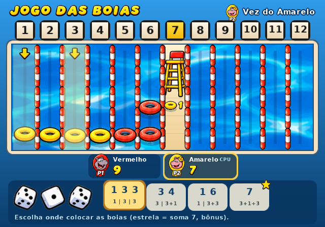
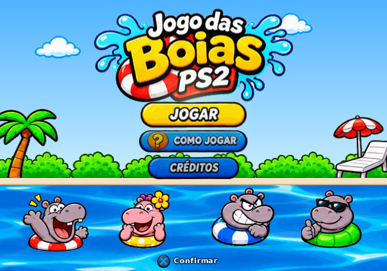
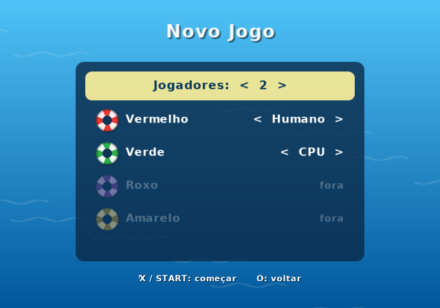
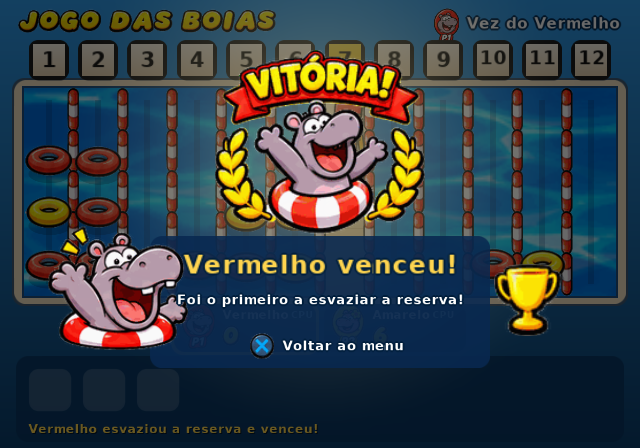

# Jogo das Boias PS2

Jogo de dados e estratégia para **PlayStation 2** (homebrew), para 2 a 4
jogadores, humanos ou CPU. Feito em C com o [PS2SDK](https://github.com/ps2dev/ps2sdk)
e o [gsKit](https://github.com/ps2dev/gsKit).



| Título | Novo jogo | Vitória |
|---|---|---|
|  |  |  |

## Como jogar

- Cada jogador começa com **12 boias** da sua cor (vermelho, amarelo, azul, verde), e cada cor tem seu hipopótamo.
  Para decidir quem começa, cada um rola um dado e o maior número começa.
- A piscina tem **12 raias**. A **raia 7 é a do salva-vidas**.
- Na sua vez, role **3 dados**. Cada dado coloca 1 boia na raia do seu número,
  ou você pode **somar 2 ou 3 dados** para alcançar raias maiores (e coloca menos boias).
  Ex.: 6, 4 e 2 permitem: raias 2, 4 e 6 / 10 e 2 / 8 e 4 / duas na 6 / uma na 12.
- A boia entra sempre **por baixo** e empurra as outras para cima. Cada raia tem
  no máximo 3 boias: se estiver cheia, a de cima é **expulsa** e volta para o dono.
- **Penalidade:** se você expulsar uma boia da **sua** cor, recolhe **todas** as
  boias daquela raia, de qualquer cor. Boias de outras cores na sua reserva
  precisam ser colocadas primeiro.
- **Bônus do 7:** somou 7 com 2 ou 3 dados? A boia vai para a raia 7 (sem limite e
  nunca volta) e você **joga de novo**. No lance bônus o 7 ainda vale, mas
  não existe terceiro lance.
- **Vence quem esvaziar a reserva primeiro.**

### Controles

| Botão | Ação |
|---|---|
| Direcional | escolher opção |
| X | confirmar / rolar os dados |
| O | voltar |
| START | pausar (continuar, ver regras, sair) |
| SELECT | liga/desliga a música |

No jogo, as cartas na parte de baixo mostram cada forma de usar os dados.
As raias que vão receber boias ficam destacadas, e as boias que seriam
expulsas ficam marcadas (em vermelho quando a jogada causaria penalidade).
A estrela indica uma jogada que soma 7 e dá bônus.
Os jogadores humanos se revezam no mesmo controle (as portas 1 e 2 funcionam).

## Rodando

Os arquivos prontos ficam em [`dist/`](dist):

- `jogo_das_boias.elf`: executável do PS2.
  - **Emulador PCSX2:** *Sistema → Iniciar ELF* (ou *Boot ELF*).
  - **PS2 real:** copie para um pendrive e abra com o uLaunchELF
    (FreeMcBoot/OpenTuna, etc.).
- `jogo_das_boias.iso`: imagem de CD (`SYSTEM.CNF` + ELF), para PCSX2 ou OPL.

## Compilando

Com o toolchain [ps2dev](https://github.com/ps2dev/ps2dev) instalado
(`PS2DEV`, `PS2SDK` e `PATH` configurados):

```sh
make          # gera jogo_das_boias.elf
make iso      # gera jogo_das_boias.iso (precisa de xorriso ou mkisofs)
make test     # testes das regras no PC (gcc)
make sim      # simulador de PC que grava capturas de tela
```

Ou com Docker:

```sh
docker run --rm -v "$PWD":/src -w /src ghcr.io/ps2dev/ps2dev:latest \
  sh -c "apk add --no-cache make xorriso && make && make iso"
```

O GitHub Actions (`.github/workflows/build.yml`) roda os testes e gera o ELF e
a ISO como artefatos a cada push.

### Simulador de PC

`build/sim` roda a mesma interface com um rasterizador em software e grava
capturas `.ppm`, sem precisar de PS2 nem de emulador:

```sh
make sim
./build/sim /tmp "w30 shot:titulo X w3 S w200 X w60 shot:jogo"
```

Comandos do roteiro: `X O T Q S L R U D` (botões), `wN` (espera N quadros),
`shot:nome` (salva captura).

## Estrutura

```
src/game.c/h      regras (C puro, sem dependência do PS2)
src/ai.c/h        jogador CPU
src/ui.c/h        telas, animações e fluxo da partida
src/render.c/h    camada de desenho (texto, formas, painéis)
src/main_ps2.c    backend PS2: gsKit (vídeo) + libpad (controles)
src/atlas.h       fonte e formas geradas por tools/gen_atlas.py (make atlas)
src/assets.h/.c   tabela de sprites e o assets.bin embutido (make assets)
src/audio.c/h     sintetizador, músicas, efeitos e mixer
src/irx.c         módulo audsrv.irx embutido (PS2)
tools/audio_demo.c  prévias em WAV (make audio-demo)
assets/src/       folhas de sprites originais
tools/sim.c       backend de PC para capturas de tela
tests/            testes das regras (inclui 300 partidas simuladas)
iso/SYSTEM.CNF    boot do CD
```

## Música e efeitos sonoros

Todo o som é sintetizado pelo próprio jogo em `src/audio.c` (sem arquivos de
áudio): steel drum, marimba, baixo, shaker, bongô e bumbo, mais os efeitos
de piscina. As músicas são composições originais:

- **Título:** calipso animado (112 BPM) com steel drum.
- **Partida:** tema tranquilo com marimba (92 BPM), para não cansar.
- **Vitória:** fanfarra curta com brilhos.

Efeitos: splash e bolhas quando a boia cai na água, "boing" quando uma boia é
expulsa, **apito do salva-vidas** na penalidade, sino na raia 7, brilho no
bônus, dados chacoalhando e caindo, e bolhinhas nos menus.

No PS2 o som sai pelo `audsrv` (módulo do IOP embutido no ELF), alimentado
por uma thread de áudio própria a 48 kHz estéreo. Para ouvir no PC:

```sh
make audio-demo   # gera build/audio/*.wav (músicas e efeitos)
SIM_WAV=/tmp/sessao.wav ./build/sim /tmp "w600 X w5 S w600"   # som de uma sessão
```

## Gráficos

Os sprites (hipopótamos, boias, dados, botões, cenário, fonte amarela e a
animação da água) vêm das folhas em `assets/src/`. O script
`tools/gen_assets.py` (`make assets`, precisa de Python 3 + Pillow + numpy)
remove o fundo branco, recorta cada sprite, reduz para 256 cores e empacota
tudo em páginas de 512x512 (`assets/assets.bin` + `src/assets.h`). No PS2
cada página vira uma textura PSMT8 com paleta, cabendo inteira na VRAM.

Para trocar um sprite, edite a folha ou o retângulo correspondente em
`tools/gen_assets.py` e rode `make assets`.

O texto pequeno usa a fonte DejaVu Sans Bold (licença livre), gerada por
`tools/gen_atlas.py`.
